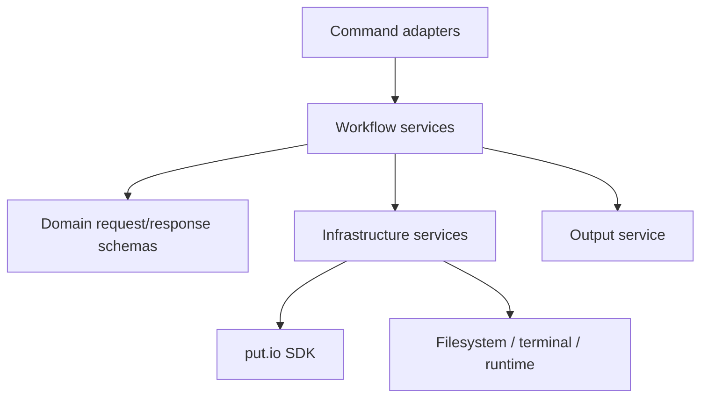

# CLI Architecture

The CLI is agent-first and Effect-native.

## Layers

- **Command adapters** (`effect/cli`): parse flags and raw `--json` input,
  decode it into typed requests, call a workflow, and pick the output mode.
- **Workflow services**: own orchestration, reach other services through
  Effect layers, and return typed results and tagged errors.
- **Infrastructure services**: terminal and runtime, output rendering, config
  and profile-aware auth, persisted state, and SDK access through the SDK's live
  layer and fetch transport.

## Invariants

- Production modules never call `Effect.run*`; `src/bin.ts` and `src/sea.ts`
  run the program through `NodeRuntime.runMain`. `check:architecture` enforces
  this.
- External data is parsed once at the boundary, then trusted.
- Commands stay thin, so workflow tests matter more than command tests.
- Structured output is the contract for scripts and agents; terminal rendering
  is an adapter over it.

## Agent Contract

- `describe` is schema-backed and lists every command's purpose, flags, raw
  JSON payload shapes, and the `automation` metadata, so agents need no prose
  docs.
- Every leaf command in `describe` has structured output; root and group
  commands such as `putio auth` print help text.
- Write commands accept raw `--json` input and `--dry-run`.
- Read commands accept `--fields`; streaming reads also accept cursor-backed
  `--page-all`.
- Field selectors and identifier-like inputs are validated before API calls.
- Auth selection order: `PUTIO_CLI_TOKEN`, then `--profile`, then
  `PUTIO_CLI_PROFILE`, then the default profile, then the legacy single-token
  config.
- Structured renderers redact sensitive values and list prompt-injection-like
  API text in `_meta.agentSafety.untrustedTextPaths`.
- [`skills/putio-cli`](../skills/putio-cli/SKILL.md) is the versioned consumer
  skill.

## Crash-Reporting Policy

### Decision

Crash reporting is an enabled-by-default diagnostic, not product analytics. It
goes to the dedicated `putio/putio-cli` Sentry project: US-hosted, Node
platform, owned by the Sentry `frontend` team.

`putio telemetry disable` writes `telemetry_disabled: true` to the private CLI
config; `enable` removes it; `status` reports it without authentication. That
boolean is the only preference. Startup reads it before initializing Sentry. A
missing config keeps reporting on; an unreadable, invalid, or unexpected config
turns it off for that process.

Release artifacts embed a validated DSN at build time. Source and pull-request
builds have none, so they never initialize Sentry or install crash handlers. CI,
agents, and other non-interactive runs use the same default and the same
persisted preference; `DO_NOT_TRACK` is not a separate control. Command
behavior is otherwise identical online and offline.

### Failure Boundary

Expected typed Effect, CLI, SDK, and API failures stay ordinary command errors.
Unexpected Effect defects, uncaught exceptions, and unhandled rejections may
send one synthetic event per process.

- Effect defects render the local error to stderr first.
- Global handlers remove themselves after the first fatal event, flush, and
  replay the original exception or rejection to Node.
- Stdout stays reserved for command results; ordinary failures keep exit
  status 1.
- Interrupt-only causes go straight to the Node runtime, so signal semantics
  hold.
- The flush deadline is 250 ms with no retry. Capture and flush failures are
  dropped. Reporting never replaces the local error or delays exit past that
  bound.

### Data

Events are built from an allowlist and projected through it again just before
transport. The transport accepts only the expected event ID and failure
category, drops SDK-internal or malformed envelopes, and rebuilds the envelope
instead of forwarding SDK output.

An event carries only: a random event ID and timestamp, a fixed message and
component and platform labels, one of three failure-category tags
(`effect_defect`, `uncaught_exception`, `unhandled_rejection`), the fixed
`production` environment, fatal level, logger, message-and-category
fingerprint, and the release `@putdotio/cli@<version>`. The envelope also
carries the public DSN routing metadata Sentry requires.

The original error, message, and stack never reach Sentry. Events also exclude
tokens, profiles, environment variables, config values, command names and
arguments, API bodies, URLs, paths, filenames, payloads, server text,
breadcrumbs, and device or user identifiers. Default integrations, client
reports, logs, tracing, server-name detection, PII capture, breadcrumbs, and
stack attachment are off. No stack is sent, so there is no source-map upload.

### Operations

Release builds read `PUTIO_CLI_SENTRY_DSN` from the protected `release`
environment, validate it as an HTTPS Sentry DSN, and fail when it is missing or
invalid. The DSN is a public routing key; Sentry auth and admin tokens stay out
of the repository and artifacts. The `frontend` team owns the project and its
support path. Events follow the put.io Sentry organization's retention and serve
debugging only.

Removal requests and sensitive reports go to the private contact in the
[put.io security policy](https://github.com/putdotio/.github/blob/main/SECURITY.md).
`putio telemetry disable` stops future events; it does not delete delivered
ones.

A local bug report should carry the CLI version, install method, OS name,
interactive or CI context, command name, output mode, and the smallest useful
sanitized stderr excerpt. It must not carry command arguments or any excluded
data above.
